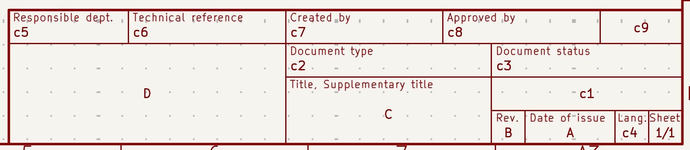

# KiCad ISO 5457 / ISO 7200 Drawing Sheet

Modified version of the official KiCad ISO 5457 / ISO 7200 drawing sheet.
All title block fields can be filled in directly from KiCad. You don't need to edit the `.kicad_wks` file.

## Installation

1. Copy the `.kicad_wks` file into your project folder.
2. In the Schematic or PCB Editor open **File → Page Settings…**
3. Under **Drawing sheet** select the file (tip: `${KIPRJMOD}/<file>.kicad_wks` keeps the path relative).

## Fields

All fields are set in **File → Page Settings…**. The marks match the picture above.
Fields in **bold** are mandatory according to ISO 7200.

| Mark | Page Settings | Title block field |
|:---:|---|---|
| A | Issue Date | **Date of issue** |
| B | Revision | Rev. |
| C | Title | **Title**, Supplementary title |
| D | Company | **Legal owner** |
| c1 | Comment1 | **Identification number** (drawing no.) |
| c2 | Comment2 | **Document type** |
| c3 | Comment3 | Document status |
| c4 | Comment4 | Lang. |
| c5 | Comment5 | Responsible dept. |
| c6 | Comment6 | Technical reference |
| c7 | Comment7 | **Created by** |
| c8 | Comment8 | **Approved by** |
| c9 | Comment9 | Free field (scale, projection, note) |

Sheet number (`1/1`) and paper size (`A3`) are filled in automatically.

**Tips**
- Date in ISO 8601 format (`YYYY-MM-DD`)
- Language as ISO 639-1 code
- Supplementary title = second line of Title (use `\n`)

## Standards

- ISO 5457:1999 (ČSN EN ISO 5457): sheet sizes, frame, grid zones
- ISO 7200:2004 (ČSN EN ISO 7200): title block data fields

## License

[CC-BY-SA 4.0](https://creativecommons.org/licenses/by-sa/4.0/).
Based on the official [KiCad templates](https://gitlab.com/kicad/libraries/kicad-templates) © KiCad contributors.
Modifications © 2026 Ondřej Brousil.

Using this drawing sheet in your designs does not require them to be CC-BY-SA licensed.
